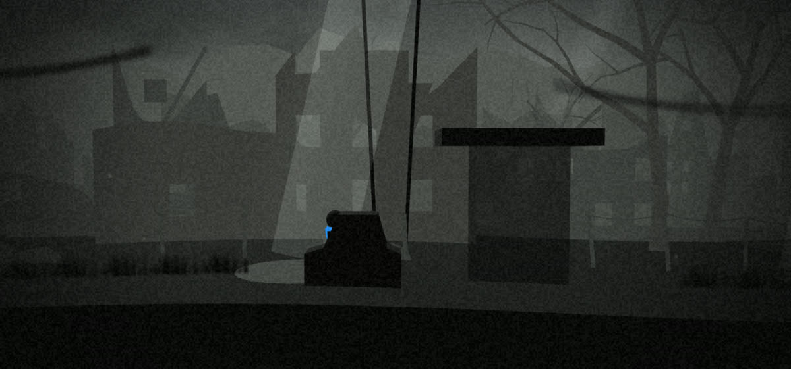

# ASHFALL

A wordless 2.5D cinematic adventure that runs in the browser. A lone child in a cracked gas mask and a bright blue scarf walks east through the ruins of a world decades after a nuclear war, drawn toward a distant signal. There is no text, no HUD and no menu, only a title fade-in. The story comes from the environment, light, sound and what happens in the background.

**Play:** https://cybersecdef.github.io/ashfall/ (landscape; on iPhone, *Share → Add to Home Screen* gives fullscreen)



## Controls

| | Phone | Keyboard | Gamepad |
| --- | --- | --- | --- |
| Walk / run | Hold left or right on the hidden pad (left half of the screen) | A / D, arrows | Left stick, d-pad |
| Jump | Up on the pad | W, Up, Space | South button |
| Crawl | Down on the pad (hold) | S, Down | Down |
| Use (lever, valve, hatch) | Tap the right half of the screen | E | West button |
| Push / pull | Tap and hold, then move | Hold E and move | Hold West and move |
| Take over a dormant body (once you have the relay) | Tap it, or tap with nothing else nearby | E | West |
| Return to the child | Tap the child, or tap with nothing nearby | E | West |

Running happens by itself after holding a direction for a moment. The child scrambles over anything up to chest height; jump at taller ledges and the child grabs the edge.

**Debug mode** (four-finger tap, or the backtick key) shows FPS, the quality tier, position and save state, and has a menu to jump to any level or checkpoint, reset the save, toggle invulnerability, sound and quality.

## The game

| Level | |
| --- | --- |
| **L01 The Shelter** | Night, falling ash. Out of a buried fallout shelter, through a dead forest, over a stream and up onto a collapsed highway. A dog wakes behind you. |
| **L02 The Dead Suburb** | Grey dawn. A glowing crater, a garden gate, and searchlights sweeping the street while masked figures are marched along the hill. |
| **L03 The Relay Yard** | A rail yard of dormant worker drones. Take them over with the relay to do what a child can't, then run for the train. |
| **L04 The Signal** | An epilogue, only for those who find all three hidden memories. |

Each level hides one memory just off the path. Progress saves automatically at invisible checkpoints; deaths respawn you there in about a second and a half, with solved puzzles left solved.

## Running it

```sh
npm install
npm run dev        # dev server with hot reload, also on your LAN (test on a phone at http://<your-ip>:5173)
npm run build      # validate levels, typecheck, build static files into dist/
npm run preview    # serve dist/
npm test           # unit, integration and full-level playthrough tests (Vitest)
npm run smoke      # headless browser checks: iPhone (WebKit) and desktop (Chromium); run after build
npm run perf       # frame times on the GPU at iPhone resolution and on a software renderer
npm run record     # render the sandbox showcase video (MP4) frame by frame
npm run docs       # regenerate the entity reference in this README
```

`npm run build` runs the level validation first: a level file with bad data fails the build. GitHub Actions builds and deploys to GitHub Pages on every push to `main`. The build uses relative paths, so `dist/` can be served from any directory (for example on trackr.live).

## How it fits together

```
src/
  engine/     game shell, level runtime, player controller, collision, boxes, camera,
              input, renderer, save, triggers, quality tiers, title, debug
  entities/   one file per entity type, params.ts (Zod schemas), registry.ts
  levels/     L00-sandbox.ts, L01..L04 data files, index.ts (order), schema.ts (validation)
  fx/         sky, depth layers and props, foreground, ash, god rays, lightning, overlay
  audio/      Web Audio engine, synthesized cues, foley
  main.ts
tests/        unit tests, mechanics scenarios, playthroughs (route.ts), docs generator
scripts/      smoke test, perf, video recorder and director, icon generator
```

- **The engine knows nothing about any level.** A level is one data file; a mechanic is one entity type. `LevelRuntime` builds everything from the level data and runs the simulation with no renderer, which is why whole levels can be played in tests. `Game` wraps it with rendering, fades, death and respawn, saving and audio.
- **2.5D.** Three.js with a perspective camera; gameplay is locked to the x/y plane at z = 0. Each background layer's scroll speed from the level data becomes a real depth (`z = D(1 - 1/speed)`), so parallax and fog are physically consistent. The path can bend toward or away from the camera (`depth` on path points) without affecting gameplay.
- **Collision** is the terrain heightfield plus solid boxes: walls, step-ups, ledges to scramble onto, ceilings that force a crawl, moving platforms that carry riders, and movable boxes with gravity and stacking.
- **Look.** Near-monochrome silhouettes; the scarf (`#1E90FF`) is the only saturated color in the game. The sky renders at reduced resolution and is upscaled; grain, vignette, flashes and fades are one full-screen pass.
- **Sound** is entirely synthesized with Web Audio (no files): wind, per-level drones, a tension pad, thunder, surface-aware footsteps, and a synth for every cue, positioned by distance. It unlocks on the first touch, as iOS requires.
- **Performance.** Quality tiers (high, medium, low) cap the pixel ratio and scale ash, god rays, sky resolution and grain. The game measures its own frame time and steps down (or back up) automatically; you can force a tier from the debug menu. It's an installable PWA that works offline.

## Adding a level

1. Copy an existing file in `src/levels/` (say `L03-relay-yard.ts`) to `L05-something.ts` and change `id`, `name`, palette, ambience, layers, path, entities, triggers, checkpoints and exit.
2. Add it to `LEVEL_FILES` in `src/levels/index.ts` and to `PLAY_ORDER` where it belongs, and point the previous level's `exit.next` at it.
3. Run `npm test`. Validation rejects unknown entity types, missing params, ids that don't resolve, anything outside the path, more than one memory, and checkpoints where standing still gets you killed.
4. Add a route for it in `tests/playthrough.test.ts`. The route plays the level headlessly and fails if it can't be finished without dying.
5. Test it on a phone: four-finger tap, then tap the level in the debug menu.

### Level fields

| Field | Meaning |
| --- | --- |
| `id`, `name` | `L05`-style id; the name is internal and never shown |
| `palette` | `sky`, `fog`, `ground` and optional `tint` colors (`#rrggbb`); keep them desaturated |
| `ambience` | `drone` (audio mood: `shelter_night`, `dead_suburb`, `rail_yard`, `signal`, `low_wind`), `wind`, `ash`, `lightning` (each 0 to 1) |
| `layers` | depth layers: `kind` (`far`, `mid`, `near`, `foreground`), `speed` relative to the play layer, `density`, `props`, `hills` |
| `path` | ground profile: points with `x`, `y`, optional `surface` (footstep sound), `sharp` (crisp corner) and `depth` (visual bend) |
| `spawn` | `{ x }` where a fresh level starts |
| `entities` | everything interactive (reference below) |
| `triggers` | x-range zones (`x`, `w`, `once`) firing `camera` (zoom, offsets), `camera_clear`, `signal` (target, signal), `lightning`, `sound` (cue), `tension` (amount) |
| `checkpoints` | x positions; passing one saves |
| `exit` | `{ x, next? }`; walking past `x` ends the level |

Signals between entities: `activate`, `deactivate` and `toggle` (gates, lifts, conveyors, searchlights, power cables), plus `alarm` for guards.

## Adding a mechanic

Add its params to `src/entities/params.ts` (and to the `entitySpec` union there), write `src/entities/<type>.ts` implementing `EntityDefinition`, and register it in `src/entities/registry.ts`. The registry's type makes a missing behavior a compile error. Then put one instance in the L00 sandbox (a test checks every type appears there), add a scenario to `tests/mechanics.test.ts`, and run `npm run docs` to update the reference below.

## Entity reference

<!-- entity-reference:start (generated by `npm run docs`; do not edit by hand) -->

Every entity also takes `x` (along the path), and optionally `id`, `y` (defaults to the ground at x) and `target` (the id it signals). 41 types:

#### Level flow

| Type | What it does | Params |
| --- | --- | --- |
| `checkpoint` | Invisible respawn point. Passing it saves progress. | none |
| `camera_hint` | A zone that eases the camera to a framing while the child is inside it. | `w` (required), `zoom`?, `offsetY`?, `offsetX`?, `seconds` = 3, `exitSeconds` = 3 |
| `background_event` | A wordless story moment in the background: plays when signalled, or when the child reaches `autoplayAt`. | `kind` (`convoy` / `marchers` / `airship`) (required), `speed` = 0.3, `span` = 40, `duration` = 14, `autoplayAt`? |
| `foreground_prop` | A hand-placed foreground silhouette (on top of the layer's random ones). | `kind` (`branches` / `grass` / `chainlink` / `wires` / `rubble`) (required), `variant` = 0, `flip` = false |
| `memory_collectible` | The level's one hidden memory: a child's drawing, a toy. Walk into it to keep it. | `kind` (`toy_rabbit` / `drawing` / `mitten` / `music_box` / `photo`) (required) |

#### Terrain and obstacles

| Type | What it does | Params |
| --- | --- | --- |
| `obstacle_low` | Knee-to-chest high: the child scrambles over it automatically. | `w` = 1, `h` = 0.5, `look` (`rubble` / `car` / `wall` / `barrel` / `slab`) = "rubble" |
| `obstacle_high` | Too tall to scramble: jump and grab the top. | `w` = 1.2, `h` = 1, `look` (`rubble` / `car` / `wall` / `barrel` / `slab`) = "wall" |
| `log` | A fallen trunk lying across the path. | `w` = 2.4, `h` = 0.42 |
| `boulder` |  | `w` = 1.1, `h` = 0.8 |
| `fence` | A fence the child can't climb. With `gap`, there is room to crawl under it. | `h` = 1.7, `gap` = 0, `w` = 0.25 |
| `crawlspace` | A low space (a fallen tree, a slab, a wreck) the child must crawl through. | `w` (required), `h` = 0.55, `look` (`tree` / `slab` / `car`) = "tree" |
| `pipe` | A culvert or vent: crawl-only, too narrow for dogs. | `w` (required), `h` = 0.6 |
| `water` | Shallow water: slows the child, splashes. | `w` (required), `depth` = 0.25 |
| `ladder` |  | `h` (required) |
| `rope` | A hanging rope from `top` (default: h above the ground), climbable but no standing at the top. | `length` (required), `top`? |

#### Movable

| Type | What it does | Params |
| --- | --- | --- |
| `crate` |  | `w` = 0.8, `h` = 0.6, `mass` = 1 |
| `cart` | Rolls a little after a push. | `w` = 1.3, `h` = 0.6, `mass` = 1.5 |
| `draggable_log` | A long, low movable: a log, a torn-off car door, a plank. Bridges gaps and pools. | `w` = 2.6, `h` = 0.35, `mass` = 1.4, `look` (`log` / `door` / `plank`) = "log" |
| `body` | A limp body. Heavy, low; weighs down plates. | `w` = 1.1, `h` = 0.3, `mass` = 1.6 |

#### Mechanisms

| Type | What it does | Params |
| --- | --- | --- |
| `lever` | Tap to flip: sends 'activate' when on, 'deactivate' when off. | `on` = false, `once` = false, `heavy` = false |
| `valve` | Tap to turn: sends 'activate' once, after a slow turn. | `turnTime` = 1.2 |
| `pressure_plate` | Held down by any actor or box standing on it: 'activate' on press, 'deactivate' on release. | `w` = 1 |
| `gate` | Opens on 'activate', closes on 'deactivate', flips on 'toggle'. | `w` = 0.3, `h` = 2.6, `open` = false, `openTo` = 0.92, `look` (`bars` / `shutter`) = "bars" |
| `lift` | A platform that rises `travel` meters on 'activate' and sinks on 'deactivate', carrying riders. | `w` = 1.6, `travel` (required), `speed` = 0.8, `up` = false |
| `conveyor` | A belt that carries whatever stands on it while running. | `w` (required), `speed` = 1, `on` = false |
| `power_cable` | Carries a signal along to its target after a short delay (a visible flicker runs along it). | `delay` = 0.6 |

#### Hazards

| Type | What it does | Params |
| --- | --- | --- |
| `radiation_zone` | Glowing fallout: lingering intensifies grain and the Geiger crackle; collapse after `lethalAfter` seconds. | `w` (required), `lethalAfter` = 3, `pool` = false |
| `falling_debris` | Rubble that falls on 'activate' (or when the child passes `triggerAt`), killing anything below; it stays as an obstacle. | `w` = 1.2, `h` = 0.5, `dropHeight` = 7, `delay` = 0.5, `triggerAt`? |
| `wire_trap` | An ankle-high tripwire. Walking or crawling through it trips it (signals `target`, or kills); jump it. | `h` = 0.18 |
| `deep_water` |  | `w` (required), `drownAfter` = 1.2 |
| `fall_height` | Anything that drops below `killY` inside [x, x + w] dies (bottomless pits). | `w` (required), `killY` (required) |

#### Threats

| Type | What it does | Params |
| --- | --- | --- |
| `feral_dog` | Sleeps until the child comes within `range` (or it gets 'activate'), then chases. Can't crawl, can't climb. | `range` = 7, `speed` = 3.9, `giveUpAfter` = 4, `wakeOnSight` = true |
| `searchlight` | A tower light sweeping the ground between x - sweep and x + sweep. Lingering in the beam (not hidden) is fatal. | `height` = 7, `sweep` = 6, `period` = 7, `phase` = 0, `on` = true |
| `patrol_drone` | Flies between `from` and `to` with a downward light. | `from` (required), `to` (required), `height` = 3.2, `speed` = 1.3 |
| `guard` | On 'alarm' he gives chase at `runSpeed`, regardless of cover. | `from` (required), `to` (required), `speed` = 0.9, `sight` = 7, `runSpeed` = 2.7 |
| `cover` | Somewhere to hide: tall grass (crawl in it), deep shadow (keep still or crawl), or a wreck (always hidden). | `w` (required), `kind` (`grass` / `shadow` / `wreck`) = "grass" |

#### Story set pieces

| Type | What it does | Params |
| --- | --- | --- |
| `hatch` | A shelter hatch overhead: tap to push it open. Closed, it is a ceiling. | `w` = 1.6 |
| `freight_car` | A rail freight car. Starts rolling east on 'activate' (or when the child passes `startAt`); jump onto it to ride. | `w` = 5, `h` = 1.2, `speed` = 2.4, `startAt`? |
| `beacon` | A lattice radio mast with a slow pale beacon at the top. Decorative: the signal the child walks toward. | `h` = 10 |

#### Relay

| Type | What it does | Params |
| --- | --- | --- |
| `relay_transmitter` | Picking it up grants the relay: tap a dormant body to control it. | none |
| `dormant_body` | An inert pre-war worker drone or hollow survivor that the relay can take over. | `kind` (`drone` / `survivor`) = "drone" |

<!-- entity-reference:end -->

## License

MIT, see [LICENSE](LICENSE).
